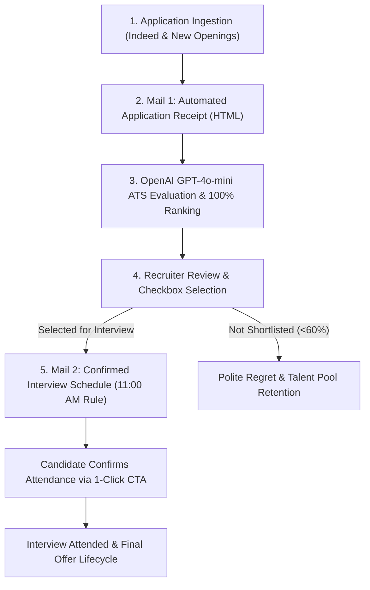

# Nunes Instrumentation — Enterprise AI ATS & Recruitment Automation Platform


[](https://python.org)
[](https://fastapi.tiangolo.com)
[](https://openai.com)
[](#)

A production-grade, enterprise Applicant Tracking System (ATS) and recruitment outreach automation platform developed for **Nunes Instruments, Coimbatore** (Industrial Testing & Instrumentation Equipment, Estd. 1974).

The platform seamlessly bridges candidate sourcing from **Indeed Employer accounts**, executes AI candidate ranking against exact job descriptions via **OpenAI**, automates strict weekday interview scheduling (**11:00 AM IST Rule**), and delivers branded, executive responsive HTML emails directly to candidates' inboxes via high-speed batch SSL SMTP.

---

## 🚀 Live Production URL

* **GitHub Repository**: [https://github.com/Sivanesanbalu/nunes-indeed-ats](https://github.com/Sivanesanbalu/nunes-indeed-ats)


---

## 📋 Comprehensive 5-Stage Recruitment Workflow



---

### Step 1: Role & Candidate Ingestion
* **Indeed Account Sync**: Ingests candidate applications, resumes, contact information, and timestamps directly from the Indeed Employer account.
* **Dynamic Opening Management (`➕ Add / Post New Opening`)**: Recruiters can dynamically create new job postings at any time with customizable job title, department, location, salary range, status (`OPEN` for active recruitment or `PAUSED` for upcoming roles), and full job descriptions.
* **Strict Zero-Missing Policy**: 100% of candidate profiles across all 15+ company job roles are ingested and tracked with unique candidate IDs.

---

### Step 2: Stage 1 Email — Initial Application Acknowledgement (Mail 1)
* As soon as candidates apply, an official application acknowledgement email is generated and delivered.
* **Anti-Spam / Duplicate Block**: The ATS enforces idempotent delivery (`mail1_status != 'SENT'`). Once sent, candidates cannot be spammed again.
* **Executive Branded HTML Design**:
  * Navy Blue Header (`#1e3a8a` – `#2557a7`) with the official company subtitle (*Industrial Testing & Instrumentation Equipment • Estd. 1974*).
  * Application logged badge and verification confirmation.
  * Clear overview of next steps and technical screening roadmap.
  * Rathinapuri, Coimbatore corporate signature with helpline contact.

---

### Step 3: OpenAI ATS Deep Matching & Continuous Ranking Engine
* **Model**: Powered by `gpt-4o-mini` with temperature 0.2 for strict, reproducible HR evaluations.
* **100% Coverage Guarantee**: Every single candidate is evaluated against the specific Job Description for their role:
  * **AI Match Score**: Accurate decimal score from `45.0` to `98.0`.
  * **Recommendation Badge**:
    * 🟢 **Shortlist** ($\ge 75.0$): High domain relevance, technical certifications, matched experience.
    * 🟡 **Consider** ($60.0 - 74.9$): Relevant foundational skills; practical experience to be verified in interview.
    * ⚪ **Review** ($< 60.0$): Lacking immediate role prerequisites.
  * **Matched Skills**: 2–4 targeted skill tags extracted directly from qualifications.
  * **Key Strengths**: Concise summary of what makes the candidate stand out.
  * **Interview Focus Gaps**: 1-sentence prompt advising interviewers what technical areas to test during the personal interview.
* **Continuous Rank Position**: Candidates are ranked `#1` to `#N` within their job opening based on score, resume density, and experience.

---

### Step 4: Recruiter Review & Checkbox Selection
* **Smart Bulk Selectors**:
  * `Select Shortlisted`: Checks all candidates with $\ge 75\%$ score in 1 click.
  * `Select Top 5` / `Select Top 10`: Selects the highest ranked candidates.
  * `Select All`: Selects all active applicants in the opening.
  * Manual individual candidate checkboxes.
* **Candidate Stage Lifecycle Tracker**:
  * `APPLIED` ➔ `THANK_YOU_SENT` ➔ `SHORTLISTED` ➔ `INTERVIEW_SCHEDULED` ➔ `ATTENDED` ➔ `SELECTED_OFFERED` / `REJECTED` / `NO_SHOW`.
* **Contact Correction & Quick Edit**:
  * In-place editor for phone numbers, personal Gmail, and Indeed relay addresses.
  * Full-text resume inspector with modal view.

---

### Step 5: Stage 2 Email — Automated 11:00 AM Weekday Interview Scheduling (Mail 2)
When the recruiter approves shortlisted candidates, the system calculates the interview day and date using the **strict weekday allocation algorithm**:

| Recruiter Approval Day | Assigned Interview Day | Interview Time |
| :--- | :--- | :--- |
| **Monday** | **Tuesday** | **11:00 AM IST (Sharp)** |
| **Tuesday** | **Wednesday** | **11:00 AM IST (Sharp)** |
| **Wednesday** | **Thursday** | **11:00 AM IST (Sharp)** |
| **Thursday** | **Friday** | **11:00 AM IST (Sharp)** |
| **Friday** | **Monday** (Skips Weekend) | **11:00 AM IST (Sharp)** |
| **Saturday / Sunday** | **Tuesday** | **11:00 AM IST (Sharp)** |

#### Mail 2 Executive Template Features:
1. **Confirmed Interview Schedule Box**:
   * Position applied, confirmed day, confirmed calendar date, and exact reporting time (**11:00 AM IST Sharp**).
   * Exact physical venue address: *11-A, 2nd Cross, Sundarar Street, Opp. Lala Mahal, Rathinapuri, Coimbatore - 641027*.
   * Clickable Google Maps Navigation link: `https://maps.google.com/?q=Nunes+Instruments+Rathinapuri+Coimbatore`.
2. **Verification Document Checklist**:
   * 2 physical copies of updated CV/Resume.
   * Educational and technical diplomas.
   * Valid Government Photo Identification (Aadhaar / Driving License).
   * Previous experience certificates or recent salary slips.
3. **Interactive 1-Click Confirmation CTA**:
   * Candidate clicks **`✓ Click Here to Confirm Attendance`**, which opens their native email app pre-populated with attendance confirmation details directly addressed to `nuneslead@gmail.com`.
4. **Duplicate Safeguard**: Candidates who already have `mail2_status == 'SENT'` are automatically protected against duplicate invitation dispatches.

---

### Step 6: Polite Regret & Talent Pool Retention
* One-click option to send dignified, professional regret notifications to candidates with review status ($< 60\%$).
* Assures candidates that their resumes are archived in the Nunes talent community for future technical openings as the company expands operations in Coimbatore.

---

## 🛡️ Email Delivery & Audit Infrastructure
* **High-Speed Batch SSL Engine**: Uses `send_smtp_email_batch` with a single persistent SSL handshake (`smtp.gmail.com:465`) to dispatch emails rapidly without HTTP request timeouts.
* **Dual Deliverability**: Automatically addresses candidate's direct email and CCs the Indeed Relay (`conversation-...@indeedemail.com`) to guarantee 100% receipt.
* **Dispatched Email Audit Ledger**:
  * Real-time ledger modal accessible from the top navbar.
  * Includes an interactive **`✉️ Toggle HTML Preview`** button allowing recruiters to inspect the exact rendered HTML layout sent to candidate inboxes.

---

## 🛠️ Architecture & Tech Stack

```text
├── api/
│   └── index.py            # FastAPI backend, SMTP engine, OpenAI ranker, SQLite CRUD
├── static/
│   └── index.html          # High-performance responsive UI, Tailwind CSS, Chart.js
├── data/
│   ├── nunes_ats.db        # Production SQLite database (candidates, roles, email logs)
│   ├── raw_candidates.json # Verified candidate application records
│   └── seed_data.json      # Complete seed catalog with 15+ openings
├── requirements.txt        # Python dependencies (fastapi, uvicorn, pydantic)
├── vercel.json             # Vercel serverless deployment routing config
└── README.md               # Enterprise documentation
```

* **Backend**: Python 3.12, FastAPI, SQLite3 with self-healing table migrations.
* **Frontend**: Pure HTML5, Modern Tailwind CSS (via CDN), Chart.js for recruitment funnel analytics, Mobile-responsive split view.
* **AI / ML**: OpenAI Chat Completions API (`gpt-4o-mini`).
* **Cloud Hosting**: Vercel Serverless Functions.

---

## 💻 Local Development Setup

### 1. Clone the Repository
```bash
git clone https://github.com/Sivanesanbalu/nunes-indeed-ats.git
cd nunes-indeed-ats
```

### 2. Configure Virtual Environment & Dependencies
```bash
python -m venv .venv
source .venv/bin/activate  # On Windows: .venv\Scripts\activate
pip install -r requirements.txt
```

### 3. Environment Variables (`.env`)
Create a `.env` file in the root directory:
```env
OPENAI_API_KEY=your_openai_api_key_here
SMTP_EMAIL=nuneslead@gmail.com
SMTP_PASSWORD=your_gmail_app_password_here
COMPANY_NAME=Nunes Instruments
```

### 4. Run Local Server
```bash
python -m uvicorn api.index:app --reload --port 8000
```
Open your browser at **`http://localhost:8000`**.

---

## 📄 License & Ownership
Copyright © 2026 **Nunes Instruments**. All rights reserved.  
Maintained by **Sivanesan Balu** ([@Sivanesanbalu](https://github.com/Sivanesanbalu)).
